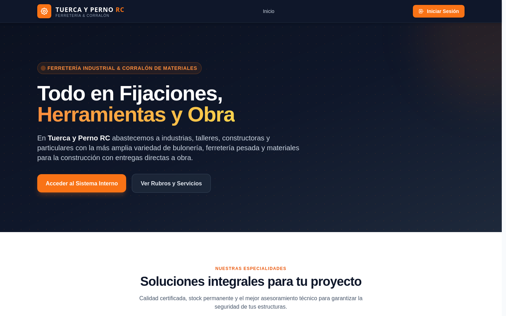
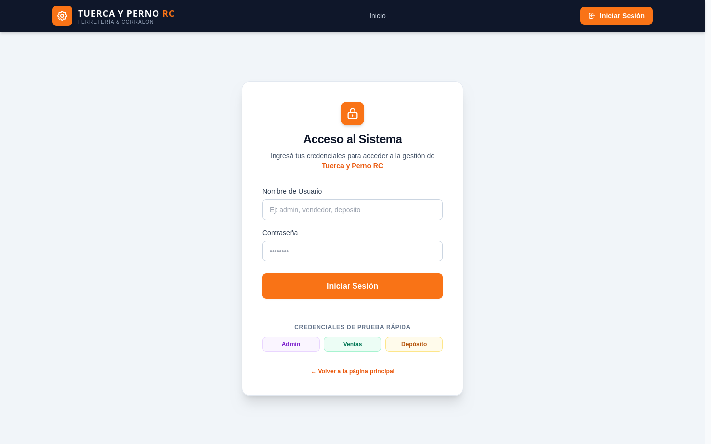
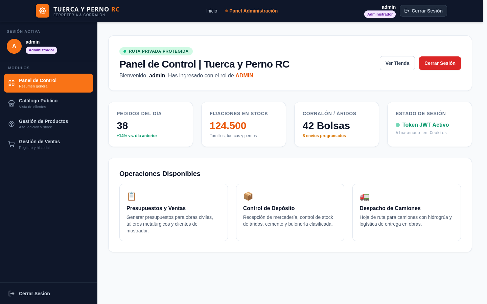
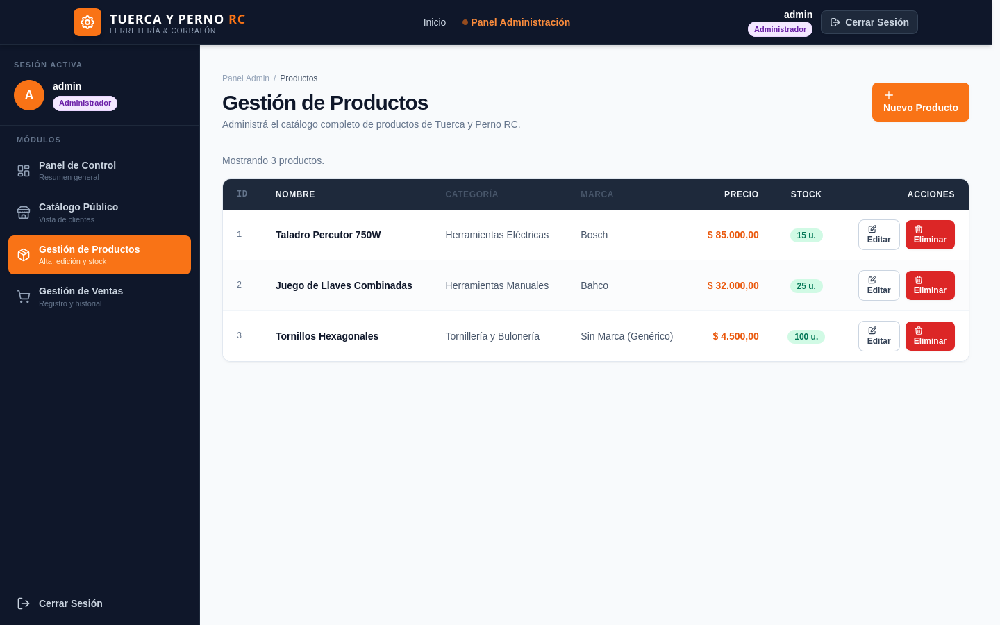
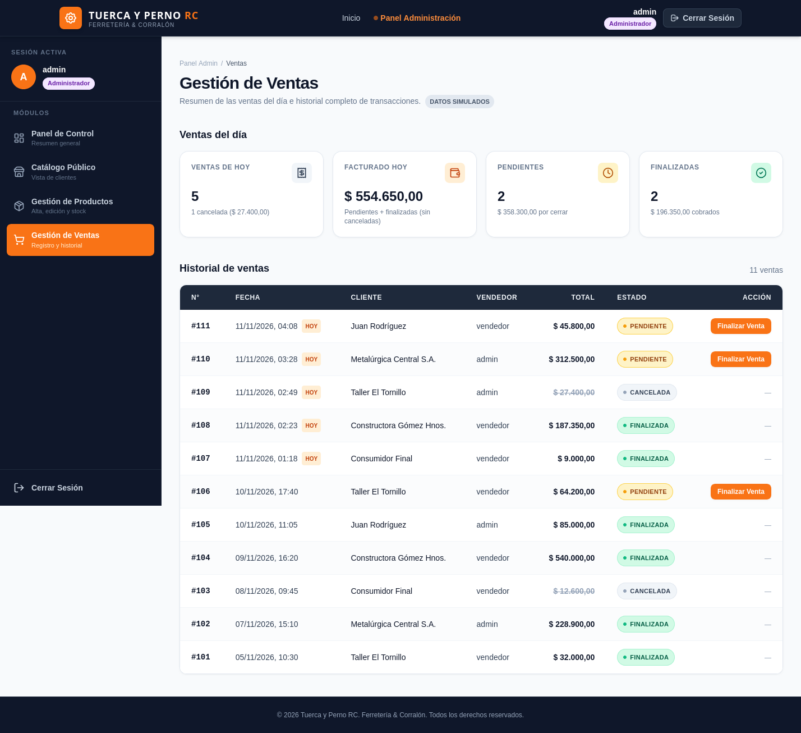
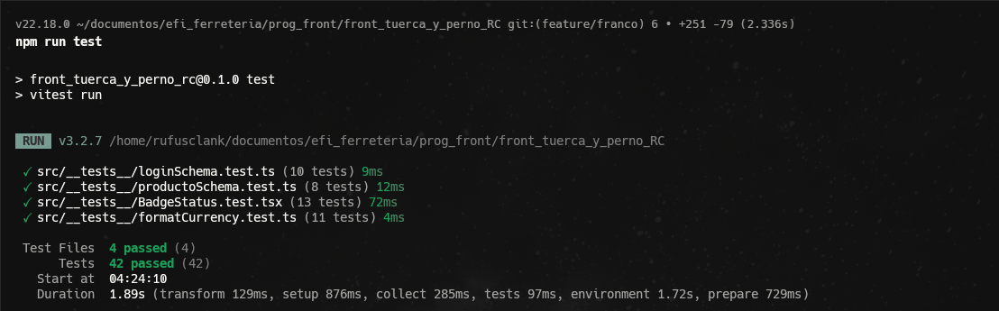

# Tuerca y Perno RC

**Sistema Web de Gestión para Ferretería Industrial y Corralón de Materiales**  
Frontend de alto rendimiento desarrollado con **Next.js 15 (App Router)**, **TypeScript** y **Tailwind CSS**, con estética industrial pesada e integrado a una API REST en **Django REST Framework** con autenticación JWT (SimpleJWT).

---

## 👥 Integrantes del Proyecto

### **Grupo: Alt + f4**

| Integrante | Nombre y Apellido | Responsabilidades principales |
| :---: | :--- | :--- |
| **1** | **Abataneo Pablo Noe** | Catálogo público: listado, filtros por categoría, búsqueda y detalle técnico de producto con stock |
| **2** | **Bressan Nadal Franco Nicolas** | Módulo de ventas, resumen métrico diario, BadgeStatus, testing unitario y documentación |
| **3** | **Cabrera Ulises** | Gestión de productos (CRUD completo), DataTable, modales de confirmación e integración con API |
| **4** | **Odetto Leandro** | Arquitectura general, autenticación (AuthContext + JWT), UI/UX industrial pesada y servicios REST |

---

## 📋 Descripción y Temática

**Tuerca y Perno RC** es una solución integral diseñada para una ferretería industrial y corralón de materiales que abastece a particulares, obras en construcción y talleres mecánicos/metalúrgicos.

El sistema digitaliza y agiliza las operaciones clave del negocio:
- **Catálogo Público de Productos**: Consulta en tiempo real de bulonería, herramientas pesadas, sanitarios y materiales de obra, con filtros por categoría, búsqueda por nombre y control de existencias.
- **Autenticación con Control de Acceso basado en Roles (RBAC)**:
  - `ADMIN`: Acceso irrestricto a todos los módulos operativos y gerenciales.
  - `VENDEDOR`: Acceso al catálogo y registro/cierre de ventas.
  - `DEPOSITO`: Gestión de inventario, stock y actualización de existencias.
- **Gestión de Inventario (CRUD)**: Alta, modificación, baja y ajuste de existencias con validaciones estrictas vía Zod y React Hook Form.
- **Gestión y Cobro de Ventas**: Panel métrico del día (facturación diaria, ventas pendientes, cobradas y canceladas) e historial general de transacciones.

---

## 🔗 Enlaces del Proyecto

| Recurso | Enlace |
| :--- | :--- |
| 🐍 **Repositorio Backend (Django REST Framework)** | [https://github.com/leandroitec/tuerca_y_perno_RC](https://github.com/leandroitec/tuerca_y_perno_RC) |
| 💻 **Repositorio Frontend (Next.js)** | [https://github.com/leandroitec/front_tuerca_y_perno_RC](https://github.com/leandroitec/front_tuerca_y_perno_RC) |
| 🚀 **Aplicación Desplegada (Producción)** | [https://front-tuerca-y-perno-rc.vercel.app](https://front-tuerca-y-perno-rc.vercel.app) *(o enlace asignado en Vercel)* |
| 📌 **Tablero de Seguimiento (Kanban)** | [Tablero Kanban del Proyecto](https://github.com/users/leandroitec/projects) *(o Jira / Trello del equipo)* |

---

## 🛠️ Stack Tecnológico

- **Framework**: Next.js 15 (App Router, estructura `src/app`)
- **Lenguaje**: TypeScript
- **Estilos**: Tailwind CSS (Diseño Industrial Pesado Anti-Look IA, paleta Caterpillar/DeWalt)
- **Validación de Formularios**: React Hook Form + Zod
- **Estado Global**: React Context API (`AuthContext` con persistencia en Cookies + LocalStorage)
- **Seguridad**: JWT (Django SimpleJWT) mediante header `Authorization: Bearer <token>` y Middleware de protección de rutas
- **Testing**: Vitest + React Testing Library + JSDOM
- **Iconografía**: Lucide React

---

## 🚀 Instalación y Ejecución Local

### Requisitos Previos

- **Node.js 18.18+** (recomendado v20 LTS o superior)
- **npm** (o yarn / pnpm)
- Backend en Django corriendo en local (`http://127.0.0.1:8000/`)

### 1. Clonar el Repositorio

```bash
git clone https://github.com/leandroitec/front_tuerca_y_perno_RC.git
cd front_tuerca_y_perno_RC
```

### 2. Instalar Dependencias

```bash
npm install
```

### 3. Configurar Variables de Entorno

Crear un archivo `.env.local` en la raíz del proyecto (basado en `.env.example`):

```bash
cp .env.example .env.local
```

Configurar la URL de conexión a la API de Django:

```env
# URL base del Backend Django REST Framework
NEXT_PUBLIC_API_URL=http://127.0.0.1:8000/
```

> 💡 **Nota**: La aplicación elimina los mocks y se conecta directamente a los endpoints reales de Django:
> - `/api/token/` (Autenticación SimpleJWT con retorno de `{ access, refresh, usuario: { id, username, rol } }`)
> - `/api/productos/` (Catálogo e inventario)
> - `/api/ventas/` (Ventas y transacciones del día)

### 4. Iniciar el Servidor de Desarrollo

```bash
npm run dev
```

Abrir [http://localhost:3000](http://localhost:3000) en el navegador.

---

## 🧪 Ejecución de Tests

La suite de pruebas automatizadas está construida con **Vitest** y **Testing Library**, asegurando la robustez de esquemas de validación Zod, renderizado de componentes y formateo de datos:

```bash
# Ejecutar los tests en consola
npm run test
```

Para ejecutar en modo vigilancia durante el desarrollo:

```bash
npm run test:watch
```

Resultado esperado (100% aprobado):
```text
 ✓ src/__tests__/formatCurrency.test.ts (11 tests)
 ✓ src/__tests__/loginSchema.test.ts (10 tests)
 ✓ src/__tests__/productoSchema.test.ts (8 tests)
 ✓ src/__tests__/BadgeStatus.test.tsx (13 tests)

 Test Files  4 passed (4)
      Tests  42 passed (42)
```

---

## 📸 Capturas de la Aplicación en Funcionamiento

### 1. Página Principal (Landing Institucional)
Diseño con temática industrial pesada, presentación de rubros de corralón y accesos directos al catálogo y sistema.


### 2. Formulario de Inicio de Sesión
Autenticación JWT contra la API de Django con validación estricta de credenciales mediante Zod.


### 3. Panel de Control y Administración
Dashboard general con métricas rápidas de inventario y facturación, con menú lateral segmentado por rol de operador.


### 4. Gestión de Productos (Inventario CRUD)
Listado tabular con ordenamiento, filtrado, indicador visual de stock por colores y acciones de edición y baja.


### 5. Gestión de Ventas y Panel Diario
Panel de métricas del día (total facturado, cobrado y pendiente) junto con el historial completo de ventas y acción de finalización.


### 6. Suite de Pruebas Unitarias (Vitest)
Validación de esquemas Zod, formateador de moneda argentina ($ ARS) y estados de badges.


---

## 📜 Scripts Disponibles

| Comando | Descripción |
| :--- | :--- |
| `npm run dev` | Inicia el entorno local de desarrollo con Hot Reload (`localhost:3000`) |
| `npm run build` | Compila y optimiza la aplicación para producción en Next.js App Router |
| `npm run start` | Arranca el servidor productivo de Next.js optimizado |
| `npm run lint` | Ejecuta el análisis estático de código con ESLint |
| `npm run test` | Ejecuta las 42 pruebas unitarias con Vitest |

---

© 2026 **Tuerca y Perno RC** — Sistema de Gestión Comercial e Industrial.  
Trabajo Integrador — **Grupo Alt + f4**.
